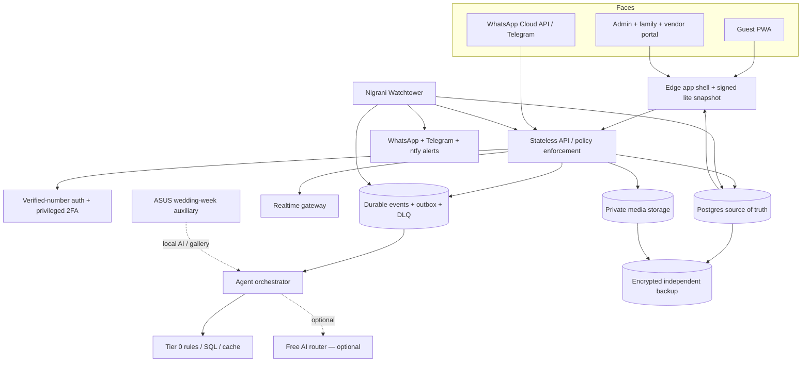

# WEDDING-OS Blueprint — Phase 1

Status: **PROVISIONAL — official quota verification blocked by environment network policy**
Constitution: approved 30 October 2026
First event: 12 February 2027, Asia/Kolkata

## Outcome and recommendation

WEDDING-OS is one private platform with three faces: guest PWA, official messaging adapters, and a role-based operations portal. The recommended direction is a **managed cardless hybrid**, conditional on Phase 1 official-limit verification: static edge PWA plus managed Postgres/realtime/object storage, with GitHub for source and automation. The ASUS laptop is an optional wedding-week worker for local AI, gallery processing and encrypted backup. It must never be required for login, RSVP, chat, alerts or Baraat tracking.

If no managed provider meets the no-card and capacity gates, the fallback is a small self-hosted core on the ASUS laptop plus a cardless static read-only site. This fallback cannot claim wedding-week availability and blocks launch until a second independent host is obtained.

## Architecture

## Failure and degradation model

| Level | Trigger | Automatic behavior | Guest message |
|---|---|---|---|
| L0 | Healthy | Full feature set within flags | None |
| L1 | AI p95 >10 s or provider circuit open | Tier 0 answers, cache, smaller provider, no background AI | “Assistant thoda slow hai Ji; confirmed details abhi available hain.” |
| L2 | All AI unavailable | Rules, SQL, buttons and human handoff only | “Main confirmed details aur family help abhi bhi de sakta hoon Ji.” |
| L3 | API/database unhealthy | Signed read-only lite snapshot; queue writes locally; messaging status page | “Live updates unavailable hain; saved schedule abhi dekh sakte hain.” |
| L4 | Security incident, queue runaway or operator panic | Freeze non-P0 writes and outbound sends; preserve SOS lane | “Safety mode active hai. Emergency help available hai.” |

## Stack comparison

| Concern | A — Managed cardless hybrid | B — ASUS self-hosted core |
|---|---|---|
| App shell | Edge static hosting | Static files through a tunnel |
| Database | Managed Postgres with RLS | Local Postgres |
| Realtime | Managed realtime/WebSocket service | Local WebSocket server |
| Media | Private object storage with signed URLs | MinIO/local disk |
| Workers | Managed functions/queues | Node workers/n8n Community Edition |
| Availability | Independent of home power; limits pending verification | Depends on laptop, power, ISP and tunnel |
| Card policy | Must be confirmed cardless before selection | No provider card; hardware/electricity already owned |
| Cold start | Provider-dependent; must be measured | None while laptop is awake |
| First failure | Realtime connections or media storage quota | Power/ISP/laptop sleep, then storage |
| Wedding-day recommendation | **Preferred if all gates pass** | Auxiliary only; primary use rejected |

## Non-negotiable boundaries

- No private data before verified phone ownership.
- No paid SMS, WhatsApp template, call, storage or compute action.
- Web/in-app is the default zero-message path. Telegram is the free messaging fallback. WhatsApp errors or unknown/positive cost open the circuit immediately; they are never retried into a billable send.
- WhatsApp Business App number is not migrated until Coexistence and backup impact are verified.
- Phone numbers, precise inactive locations, vendor costs, budget, disputes, health details and credentials never enter guest-visible responses.
- AI cannot authorize tools, publish facts, spend money, change permissions or operate kill switches.
- All external writes use idempotency keys, an outbox, bounded retries and a dead-letter queue.
- Every production feature starts disabled until its matrix gates pass.

## Data ownership and event flow

Postgres is the sole mutable source of truth. Google Sheets and CSV are adapters, never parallel authorities. Conflicts use: explicit admin edit > verified guest self-update > newest trusted adapter value > existing record. Every mutation writes an immutable domain event and audit entry in the same transaction. Workers claim events with a lease, deduplicate by idempotency key, retry with jittered exponential backoff and move exhausted work to the DLQ.

## Media budget model

Planning assumption, not provider quota: 600 guests × 8 compressed images × 0.45 MB = 2.16 GB; thumbnails add 0.35 GB; 120 videos × 8 MB = 0.96 GB; working headroom and metadata bring the target to **5 GB**. The client strips EXIF, limits images to about 1600 px and videos to 15/30 seconds. Uploads stop safely before the verified provider ceiling. Daily encrypted export goes to a second location. Originals are optional and admin-controlled.

## Security model

Opaque 30-day HTTP-only sessions; device list and global logout; E.164 normalization; HMAC lookup plus encrypted phone storage; IP and number rate limits; privileged 2FA; server-side RBAC on every operation; RLS as defense in depth; signed and scanned media uploads; webhook signature and replay verification; CSP; output encoding; PII-redacted structured logs; step-up PIN for A3 portal actions; deterministic kill switches outside all AI paths.

## Phase 1 acceptance blocker

The selected managed provider and WhatsApp design remain conditional until official pricing, card, connection, storage, message and policy pages are accessible and recorded with a verification date. No account or production architecture is approved from remembered limits.
