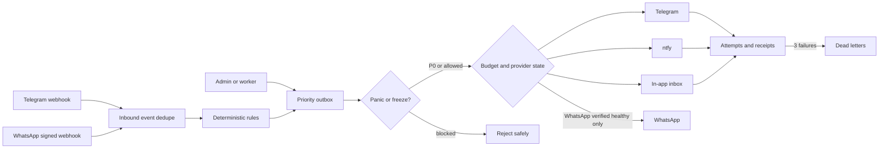

# Messaging Spine Blueprint — Phase 3

Phase 3 adds a deterministic messaging core that remains useful with WhatsApp and AI unavailable. Every inbound provider event has a provider/external-ID uniqueness boundary. Every outbound message has an idempotency key, priority, durable state, attempts and a terminal dead-letter record. P0 bypasses non-P0 freezes. WhatsApp starts disabled and BLACK; requests route to Telegram when a Telegram recipient is known, otherwise to the in-app web inbox.

## Budget modes

- GREEN: below 60% of a verified free allowance.
- AMBER: 60% to below 85%; prefer combined messages and Telegram/web.
- RED: 85% to below 100%; critical WhatsApp only.
- BLACK: allowance absent or exhausted; WhatsApp disabled and free fallback used.

The system never infers a WhatsApp allowance. An admin must explicitly submit `verifiedFree: true` with an official allowance. This records the budget but does not enable the provider; eligibility and credentials remain a separate gate.

## Controls

- `freeze.posting`
- `freeze.chat`
- `freeze.non_p0`
- `panic`

Controls are database-backed, admin-only and audited. `freeze.non_p0` and `panic` reject every non-P0 enqueue operation.
