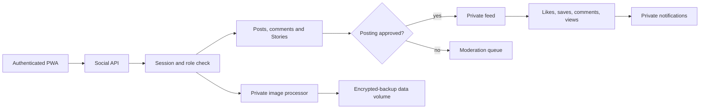

# Private Social Layer — Phase 4

Phase 4 turns the sample wedding feed into authenticated, wedding-only social data. Phone numbers never enter social queries. New guest posts and Stories enter moderation; family and admin content can publish directly. Story viewers are unique by `(story_id, viewer_id)`, and only the author or admin can retrieve viewer names. Images are private, re-encoded to WebP, limited to 1600px and stripped of metadata.

## Privacy and safety rules

- Every route requires a verified session.
- Feed and profiles expose names, side and relation but never phone data.
- External links are rejected in captions, comments, Stories and bios.
- Blocks are bilateral for feed and Story visibility; mutes hide feed authors.
- Reports create moderation work without auto-deleting content.
- Delete operations soft-delete content for audit and recovery.
- Videos return `video_not_enabled` until safe duration/transcoding controls pass.
