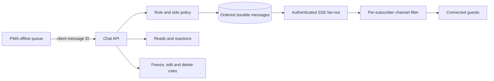

# Live Chat Blueprint — Phase 5

Phase 5 provides private wedding channels over authenticated SSE with durable SQLite history. Client-generated IDs make offline resend idempotent. Every subscriber is filtered through channel visibility before an event is emitted, so side-room content is never broadcast to the other side. Direct messages remain disabled.

Channels: Announcements, Everyone, Sagai, Haldi, Mehndi, Wedding, Bride's side and Groom's side. Announcements are admin/family-posted. Side rooms require matching side or elevated family/admin role.
